<p align="center">
  <a href="https://laravel.com" target="_blank">
    
  </a>
</p>

<p align="center">
  <a href="https://github.com/laravel/framework/actions"></a>
  <a href="https://packagist.org/packages/laravel/framework"></a>
  <a href="https://packagist.org/packages/laravel/framework"></a>
  <a href="https://packagist.org/packages/laravel/framework"></a>
</p>

<h1 align="center">Laboratorio de Laravel: Introducción al Framework MVC</h1>

<p align="center">
  <strong>Autor: Vasdti Legaspi</strong>
</p>

## Introducción

Este repositorio documenta el desarrollo del laboratorio de introducción al framework Laravel, siguiendo la guía proporcionada en la asignatura de Desarrollo Web de la Universidad Tecnológica de Panamá.

Durante esta práctica se trabajó con la preparación del entorno de desarrollo, la creación de un proyecto Laravel, la configuración de la conexión con MySQL, la ejecución de migraciones, la ejecución de la aplicación y la generación de vistas de autenticación mediante Bootstrap.

Las imágenes se presentan en el mismo orden del documento de evidencias. Cada captura incluye una explicación del procedimiento o resultado que representa.

## Objetivos

- Familiarizarse con la estructura básica de un proyecto Laravel.
- Comprender la organización del framework y el patrón Modelo-Vista-Controlador (MVC).
- Crear un proyecto utilizando Composer y Laravel.
- Configurar las variables de entorno y la conexión con MySQL.
- Ejecutar migraciones mediante Artisan.
- Iniciar el servidor de desarrollo y comprobar la aplicación.
- Generar vistas de inicio de sesión y registro utilizando Laravel UI y Bootstrap.
- Documentar el proceso mediante capturas de pantalla.

## Herramientas utilizadas

- **Laravel:** framework de desarrollo web.
- **PHP:** lenguaje utilizado por Laravel.
- **Composer:** administrador de dependencias de PHP.
- **Node.js y npm:** herramientas para gestionar recursos del frontend.
- **WampServer:** entorno de desarrollo local.
- **MySQL:** sistema de gestión de bases de datos.
- **phpMyAdmin:** herramienta para administrar la base de datos.
- **Bootstrap:** framework utilizado para los estilos de las vistas.
- **GitHub:** plataforma utilizada para documentar y compartir el laboratorio.

## Desarrollo del laboratorio

### Imagen 1. Preparación del proyecto Laravel

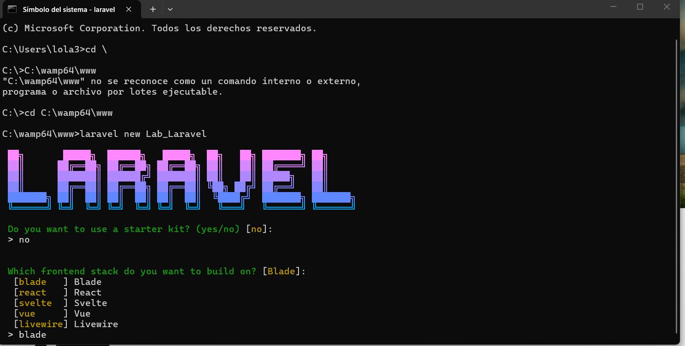

En esta primera evidencia se muestra el inicio del proceso de trabajo con Laravel. Se prepara el entorno y se realizan las acciones iniciales necesarias para comenzar el laboratorio.

### Imagen 2. Ejecución de comandos en la terminal

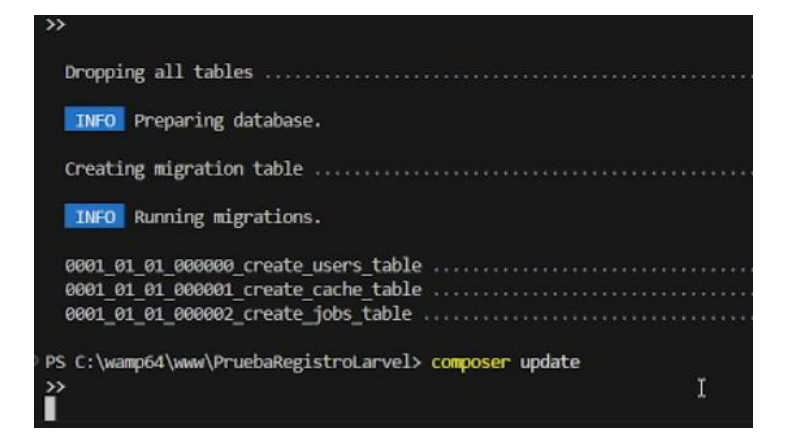

En esta captura se observa el uso de la terminal para ejecutar comandos relacionados con el proyecto. La terminal permite administrar dependencias, ejecutar instrucciones de Artisan y realizar configuraciones necesarias durante el desarrollo.

### Imagen 3. Comprobación de WampServer

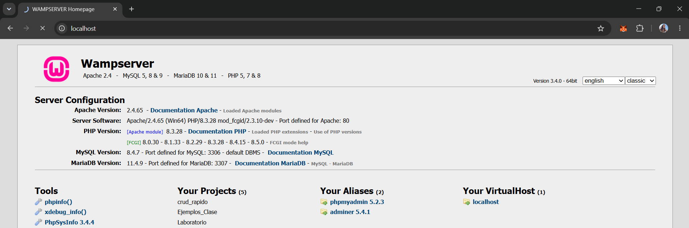

En esta imagen se muestra WampServer, utilizado como entorno local para el desarrollo. Se comprueba el entorno que permite ejecutar aplicaciones PHP y trabajar con MySQL.

### Imagen 4. Administración de la base de datos

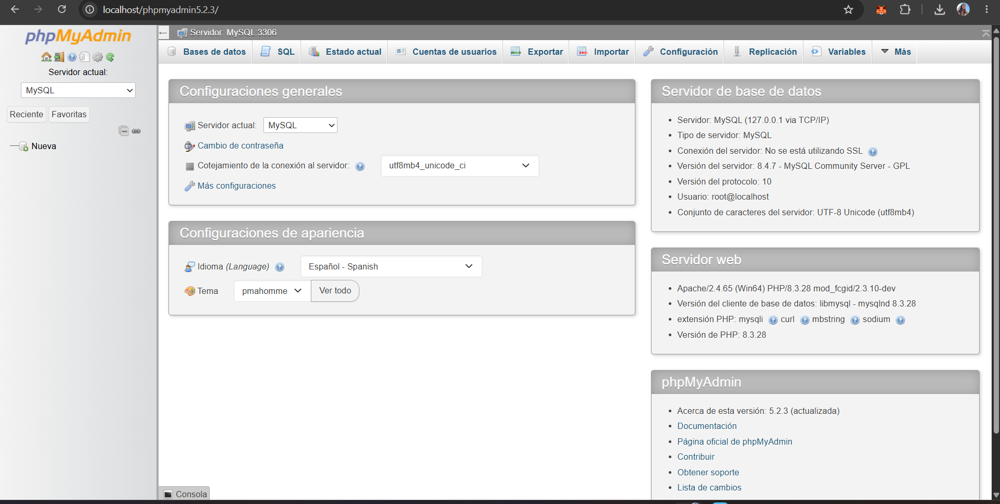

Esta evidencia corresponde al trabajo con la base de datos mediante phpMyAdmin. Esta herramienta permite visualizar las bases de datos, consultar las tablas existentes y comprobar la estructura generada durante el desarrollo.

### Imagen 5. Configuración y ejecución de migraciones

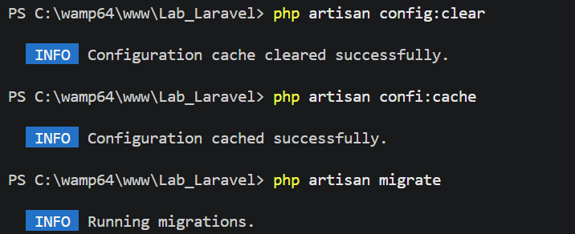

En esta etapa se trabaja con los comandos de Artisan relacionados con la configuración del proyecto y la base de datos.

```bash
php artisan config:clear
php artisan config:cache
php artisan migrate
```

El comando `config:clear` elimina la caché de configuración, `config:cache` vuelve a generarla y `migrate` ejecuta las migraciones pendientes definidas en `database/migrations`.

### Imagen 6. Inicio del servidor de Laravel

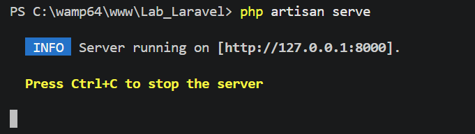

En esta captura se muestra el proceso de inicio del servidor de desarrollo de Laravel. El comando utilizado para iniciar el servidor es:

```bash
php artisan serve
```

Cuando se inicia correctamente, la terminal muestra la dirección local desde la cual se puede acceder a la aplicación mediante el navegador.

### Imagen 7. Visualización de Laravel en el navegador

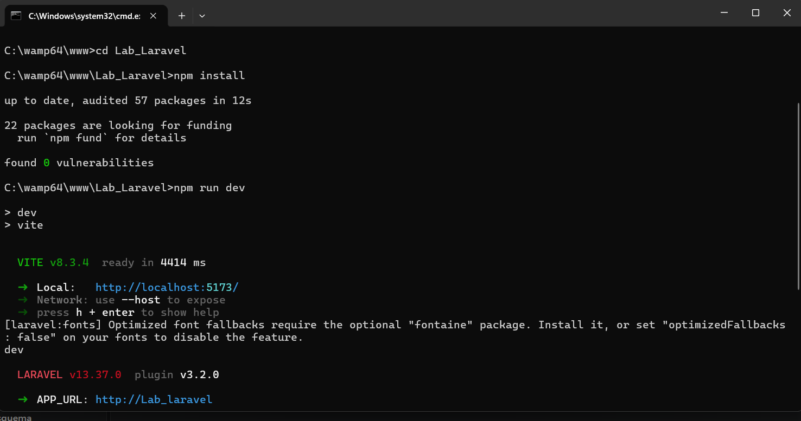

En esta imagen se observa la aplicación Laravel abierta en el navegador. Esta comprobación permite verificar visualmente el funcionamiento de la aplicación en el entorno local.

### Imagen 8. Identificación de un error en la aplicación

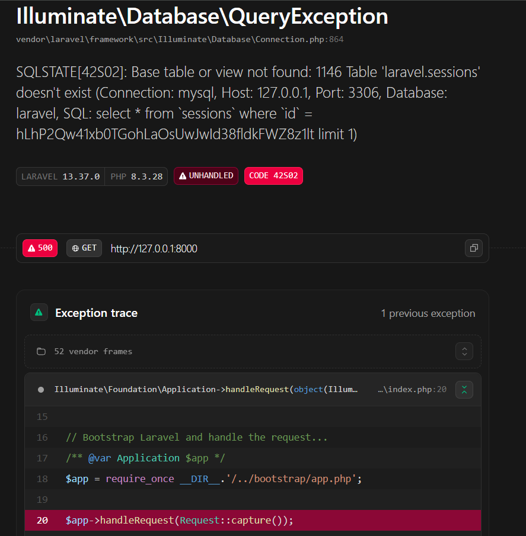

En esta evidencia se muestra un mensaje de error relacionado con una operación de base de datos. Este tipo de situación destaca la importancia de revisar la configuración de conexión definida en `.env` y comprobar que el servicio MySQL se encuentre activo. La captura documenta un problema encontrado durante el laboratorio.

### Imagen 9. Comprobación de la aplicación Laravel

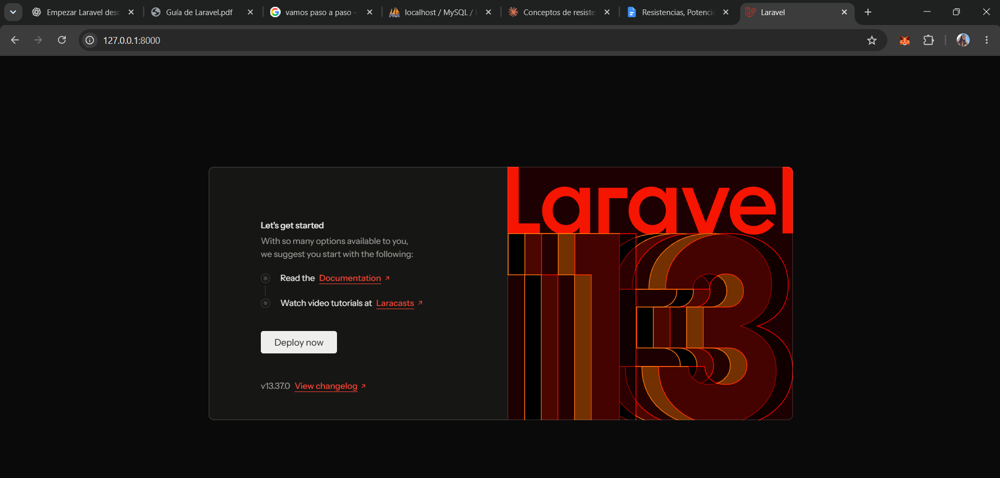

En esta captura se muestra la aplicación en el navegador. Esta evidencia permite observar el resultado visual del proyecto durante las comprobaciones realizadas en el entorno de desarrollo.

### Imagen 10. Instalación de dependencias

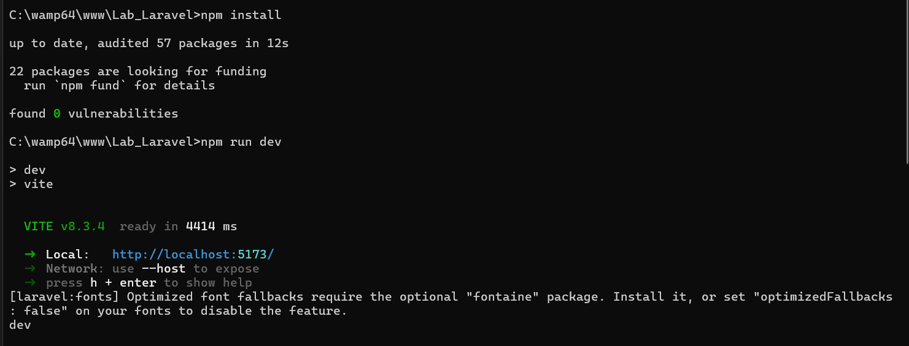

En esta etapa se trabaja con las dependencias necesarias para el funcionamiento de los recursos del frontend. El comando utilizado para instalar los paquetes definidos en `package.json` es:

```bash
npm install
```

### Imagen 11. Ejecución de las migraciones

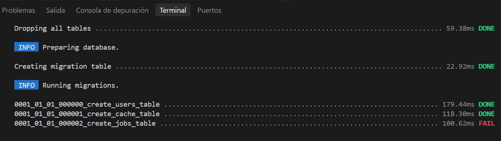

En esta evidencia se muestra el resultado de las operaciones relacionadas con las migraciones de Laravel. Las migraciones permiten definir y mantener la estructura de la base de datos mediante archivos PHP. Laravel registra las migraciones ejecutadas en la tabla `migrations`.

### Imagen 12. Revisión de la base de datos

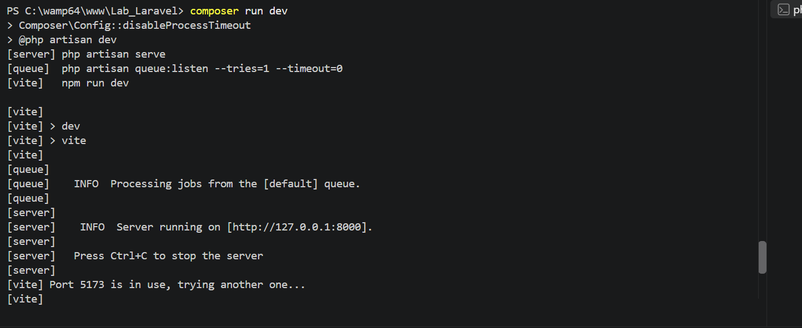

En esta captura se observa la revisión de la base de datos y de los elementos generados durante el proceso. Esta comprobación forma parte de la verificación de la estructura necesaria para el funcionamiento de la aplicación.

### Imagen 13. Continuación de las comprobaciones del proyecto

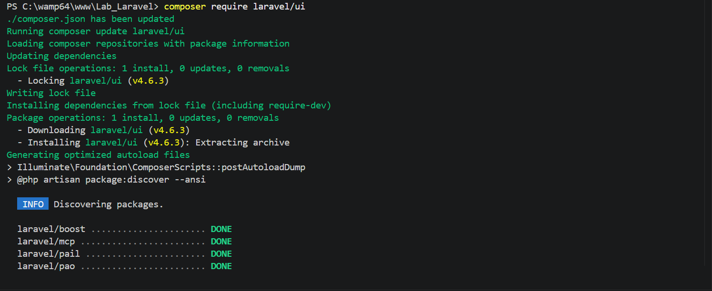

En esta etapa se continúa trabajando con la configuración y ejecución del proyecto. Se revisan los elementos necesarios para que Laravel pueda funcionar antes de continuar con la preparación de las vistas de autenticación.

### Imagen 14. Instalación del paquete Laravel UI

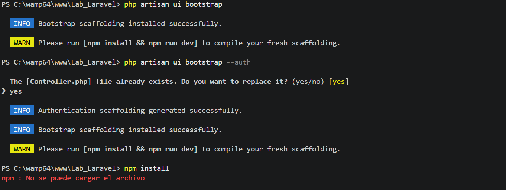

En esta evidencia se trabaja con la instalación del paquete `laravel/ui`, utilizado en la guía para generar estructuras de interfaz y recursos de autenticación en las versiones compatibles de Laravel.

```bash
composer require laravel/ui
```

Composer descarga e incorpora el paquete al proyecto y actualiza los archivos de dependencias correspondientes.

### Imagen 15. Configuración de Bootstrap y autenticación

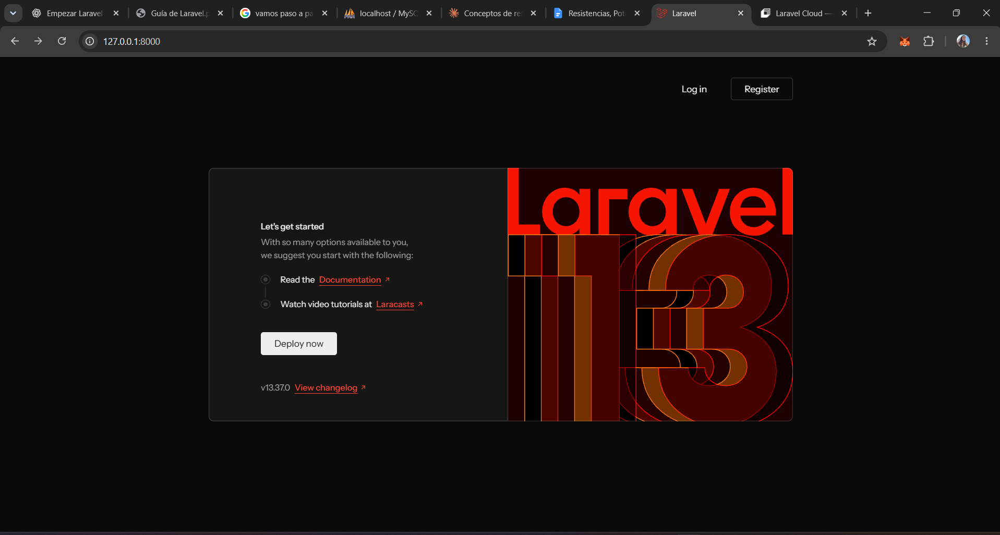

En esta etapa se generan los recursos del frontend utilizando Bootstrap mediante Laravel UI.

```bash
php artisan ui bootstrap
php artisan ui bootstrap --auth
```

El primer comando genera los recursos necesarios para utilizar Bootstrap. El segundo solicita la generación de vistas de autenticación, como inicio de sesión y registro, en las versiones compatibles con el paquete.

### Imagen 16. Instalación y ejecución de recursos del frontend

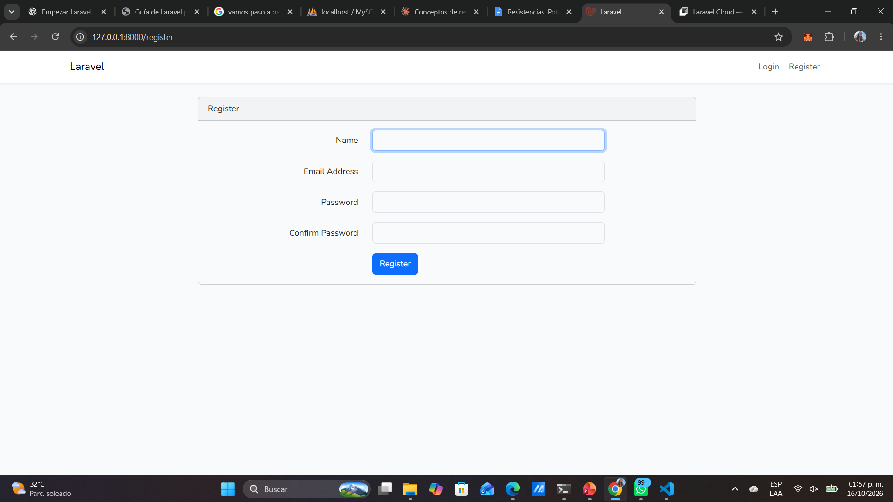

En esta captura se documenta el trabajo con las dependencias del frontend. Los comandos indicados en la guía son:

```bash
npm install
npm run dev
```

Estos comandos permiten instalar las dependencias y ejecutar las herramientas de desarrollo del frontend.

### Imagen 17. Comprobación de la interfaz de autenticación

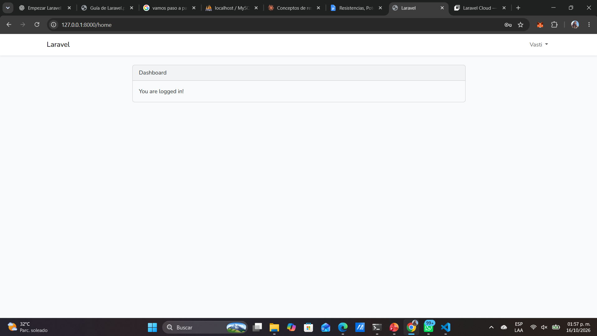

En esta evidencia se muestra la interfaz relacionada con el sistema de autenticación. Estas vistas permiten disponer de formularios para iniciar sesión o registrarse, según los recursos generados durante la práctica.

### Imagen 18. Comprobación final de la aplicación

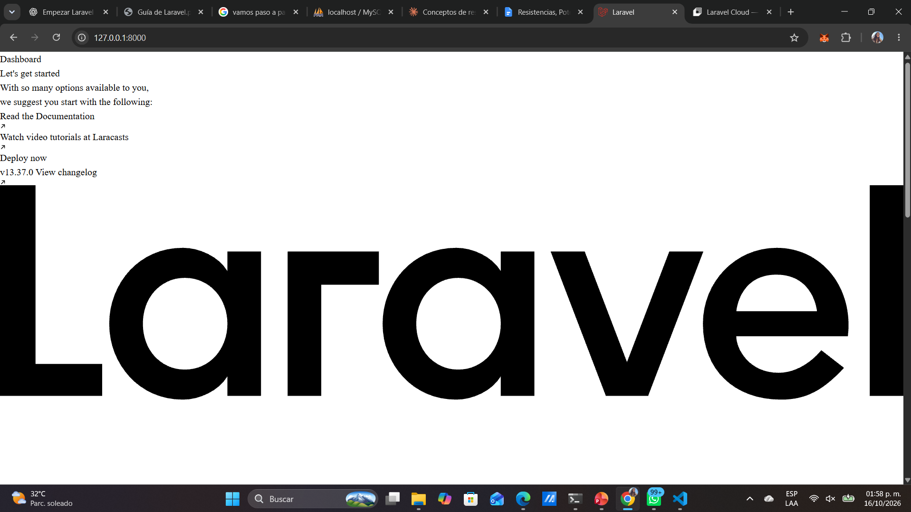

En la última captura se muestra la aplicación Laravel en el navegador como parte de las comprobaciones finales del laboratorio. Esta evidencia cierra el recorrido documentado del trabajo realizado.

## Comandos principales utilizados

### Crear un proyecto Laravel

```bash
laravel new NombreProyecto
```

Como alternativa, se puede utilizar Composer:

```bash
composer create-project laravel/laravel mi-proyecto
```

### Ejecutar migraciones

```bash
php artisan migrate
```

### Limpiar y reconstruir la configuración

```bash
php artisan config:clear
php artisan config:cache
```

### Iniciar el servidor de desarrollo

```bash
php artisan serve
```

### Instalar Laravel UI y generar las vistas

```bash
composer require laravel/ui
php artisan ui bootstrap
php artisan ui bootstrap --auth
```

### Instalar y ejecutar dependencias del frontend

```bash
npm install
npm run dev
```

En proyectos que tengan configurado el script correspondiente en `composer.json`, también se puede utilizar:

```bash
composer run dev
```

Este comando puede iniciar conjuntamente el servidor de Laravel y Vite, según la configuración del proyecto.

## Configuración de la base de datos

La conexión con MySQL se configura en el archivo `.env`, ubicado en la raíz del proyecto. Los parámetros deben adaptarse a la configuración del entorno local utilizado. Por ejemplo:

```env
DB_CONNECTION=mysql
DB_HOST=127.0.0.1
DB_PORT=3306
DB_DATABASE=nombre_de_la_base_de_datos
DB_USERNAME=root
DB_PASSWORD=
```

Después de modificar las variables de entorno, se recomienda limpiar la caché de configuración antes de volver a ejecutar las migraciones.

## About Laravel

Laravel es un framework para aplicaciones web con una sintaxis expresiva y elegante. Facilita tareas comunes del desarrollo web, como:

- Enrutamiento rápido y sencillo.
- Contenedor de inyección de dependencias.
- Gestión de sesiones y caché.
- ORM para trabajar con bases de datos mediante Eloquent.
- Migraciones de esquemas de base de datos.
- Procesamiento de trabajos en segundo plano.
- Difusión de eventos en tiempo real.

Laravel ofrece herramientas para desarrollar aplicaciones web robustas y mantenibles.

## Learning Laravel

La documentación oficial de Laravel incluye guías y ejemplos para aprender a utilizar el framework:

- [Documentación oficial de Laravel](https://laravel.com/docs)
- [Laravel Learn](https://laravel.com/learn)
- [Laracasts](https://laracasts.com)

## Agentic Development

Laravel también dispone de herramientas para flujos de desarrollo asistidos por agentes de programación. Una de ellas es Laravel Boost, cuya documentación se encuentra en [Laravel AI](https://laravel.com/docs/ai).

Los comandos de instalación que aparecen en la documentación de Boost son:

```bash
composer require laravel/boost --dev
php artisan boost:install
```

Estos comandos son información complementaria de Laravel y no forman parte de los pasos principales documentados en este laboratorio.

## Contributing

Este repositorio documenta una práctica académica. Para conocer las pautas de contribución al framework Laravel, consulta la [guía oficial de contribuciones](https://laravel.com/docs/contributions).

## Code of Conduct

Laravel mantiene un código de conducta para fomentar una comunidad respetuosa e inclusiva. Puede consultarse en el [Código de Conducta de Laravel](https://laravel.com/docs/contributions#code-of-conduct).

## Security Vulnerabilities

Para obtener información sobre cómo reportar vulnerabilidades de seguridad en el framework Laravel, consulta la [documentación oficial de seguridad](https://laravel.com/docs).

## License

Laravel es software de código abierto distribuido bajo la licencia [MIT](https://opensource.org/licenses/MIT).

## Conclusión

Durante este laboratorio se recorrieron los procedimientos básicos para comenzar a desarrollar una aplicación utilizando Laravel. Se revisó el entorno local, se ejecutaron comandos desde la terminal, se trabajó con la configuración de la base de datos y se exploró el uso de migraciones.

También se documentó la ejecución de la aplicación en el navegador y la generación de vistas de autenticación mediante Laravel UI y Bootstrap, siguiendo los pasos indicados en la guía.

Las capturas conservan evidencia del desarrollo de la práctica, incluyendo las comprobaciones realizadas y los errores encontrados durante el proceso.

## Referencia académica

**Guía de Laboratorio: Introducción al Framework Laravel – MVC.** Universidad Tecnológica de Panamá, Facultad de Ingeniería en Sistemas Computacionales, asignatura de Desarrollo Web. Docente: Ing. Irina Fong.

---

<p align="center">Documentación del laboratorio realizada por <strong>Vasdti Legaspi</strong>.</p>
